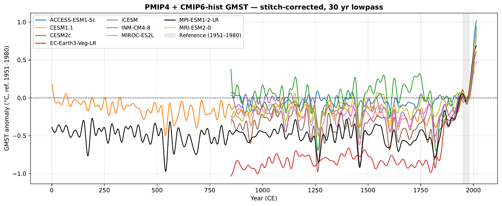
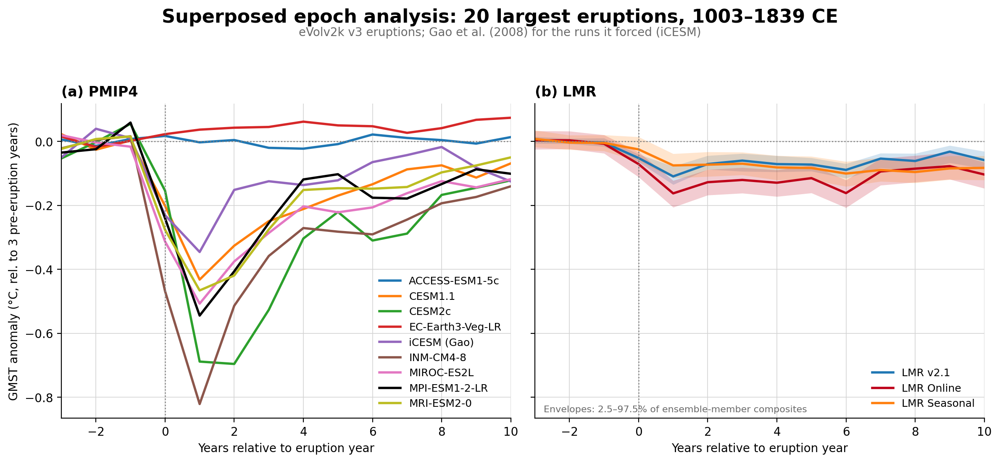

# ce_fields

[](https://doi.org/10.5281/zenodo.23930848)

Utilities to access Common Era climate fields, to enable several
projects can share them without duplicating loading logic:

- **Simulations:** loading, stitching, and bias-correcting PMIP4 past1000/past2k
  and CMIP6-historical runs (`products`, `pmip4_config`, `io`).
- **Reconstructions:** the Last Millennium Reanalysis, v2.1, Online and Seasonal
  (`lmr`), and the six Neukom et al. (2019) field reconstructions (`neukom`).
- **Instrumental:** gridded temperature products (HadCRUT5, CRUTEM5, Berkeley
  Earth, DCENT-I), always loaded by explicit version (`instrumental`).

Note: this was primarily meant to grease the wheels of data loading for the USC Climate Dynamics group. The data registry will need to be heavily edited to be useful to anyone else, but the repository provides a roadmap for how to organize such files, and how to access their data painlessly once paths are set up.

## Install

With conda (pinned, tested versions; includes the regridding and script
dependencies):

```bash
conda env create -f environment.yml
conda activate ce_fields
```

or with pip only (minimum versions):

```bash
pip install -e .
```

## Usage

```python
from ce_fields import DataConfig, load_corrected_tas

config = DataConfig()
tas = load_corrected_tas('ACCESS-ESM1-5', config=config)  # stitched annual tas, 1850-bias-corrected by default
print(tas.attrs['display_name'])  # 'ACCESS-ESM1-5c' -- use this label in plots/tables

# To audit against the original, uncorrected data instead:
raw = load_corrected_tas('ACCESS-ESM1-5', config=config, use_corrected=False)
print(raw.attrs['display_name'])  # 'ACCESS-ESM1-5'
```

Only ACCESS-ESM1-5 and CESM2 have a registered pre-1850 correction (see
`ce_fields.pmip4_config.CORRECTED_MODELS`); `use_corrected` has no effect for
any other model. Always read the label from `attrs['display_name']` rather
than hardcoding it, so plots/tables stay honest about which series were
corrected.

See `ce_fields/products.py` for the full API (`load_stitched_tas`, `load_corrected_tas`, `compute_gmst`).

Reconstructions:

```python
from ce_fields import LMR, Neukom2019
```

Everything public is importable from the package itself (`from ce_fields import ...`).

Instrumental products are loaded by **explicit version**. There is no default
and no "latest", because each release revises past values:

```python
from ce_fields import Instrumental

Instrumental.catalog()                                    # registered (product, version, variable, kind), and found here
hc = Instrumental.from_version('hadcrut5', '5.1.0.0')     # annual field, (year, lat, lon), lon 0-360
gmst = hc.gmst(ref_period=(1951, 1980))                   # cos(lat)-weighted, re-centered
hc.label                                                  # 'HadCRUT5 v5.1.0.0' -- use in plots/tables
dcent = Instrumental.from_version('dcent_i', '1.1.0.0', kind='members')   # 200 members, lazily
```

Each catalog entry carries a `version_check` against the file's own metadata,
and loading refuses a file that fails it. Years with fewer than 12 months
(the running year of an operational release) are dropped when annualizing.
Products keep their native baselines (in `data.attrs['native_baseline']`)
unless `ref_period` is given. To register a new release, copy its product's
entry in `ce_fields/data_config.yml` and change the version, path and
`version_check`.

## Data

The fields themselves are not distributed with this package: they are large
and published elsewhere. To work with them, download local copies and tell
`ce_fields` where they are (see [Data configuration](#data-configuration)).
Repositories such as
[borehole_val](https://github.com/LinkedEarth/borehole_val) archive the
intermediate products derived from these fields, so their figures and tables
can be rebuilt without them.

| Dataset | Root key | Files used | Size | Source |
|---|---|---|---|---|
| PMIP4 `past1000`/`past2k` and CMIP6 `historical` monthly `tas` (9 models) | `pmip4_data`, `cmip_hist_data` | see `ce_fields/data_config.yml` | several GB per model and experiment | [ESGF](https://esgf.llnl.gov/) |
| LMR v2.1 ([Tardif et al., 2019](https://doi.org/10.5194/cp-15-1251-2019)) | `lmr_data` | `LMRv2.1/`: gridded ensemble mean and spread, GMST ensemble | 2.3 GB (GMST only: 12 MB) | NCEI Paleoclimatology, <https://www.atmos.uw.edu/~hakim/lmr/> |
| LMR Online ([Perkins and Hakim, 2021](https://doi.org/10.1029/2020PA003959)) | `lmr_data` | `LMRonline/…/`: gridded ensemble mean and variance, GMST indices | 1.4 GB (GMST only: 153 MB) | NCEI Paleoclimatology, <https://www.atmos.uw.edu/~hakim/lmr/> |
| LMR Seasonal ([Meng et al., 2025](https://doi.org/10.1175/JCLI-D-25-0048.1)) | `lmr_data` | `LMR_seasonal/`: gridded ensemble mean, GMST ensemble | 0.6 GB (GMST only: 29 MB) | <https://atmos.uw.edu/~zilumeng/LMR_Seasonal/data/> |
| HadCRUT5 ([Morice et al., 2021](https://doi.org/10.1029/2019JD032361)): v5.0.1.0, v5.0.2.0, v5.1.0.0 | `hadcrut5_data` | `HadCRUT.<version>.analysis.anomalies.ensemble_mean.nc` | ~30 MB per version | [Met Office](https://www.metoffice.gov.uk/hadobs/hadcrut5/) |
| CRUTEM5 ([Osborn et al., 2021](https://doi.org/10.1029/2019JD032352)): v5.0.2.0 | `crutem5_data` | `CRUTEM.5.0.2.0.anomalies.nc` | 12 MB | [Met Office](https://www.metoffice.gov.uk/hadobs/crutem5/) |
| Berkeley Earth land TAVG, 1x1 deg ([Rohde and Hausfather, 2020](https://doi.org/10.5194/essd-12-3469-2020)): build 2025-01-09 | `berkeley_earth_data` | `Complete_TAVG_LatLong1.nc` | 190 MB | [Berkeley Earth](https://berkeleyearth.org/data/) |
| DCENT-I ([Chan et al., 2026](https://doi.org/10.1002/gdj3.70054)): v1.1.0.0 | `dcent_data` | `v1.1.0/DCENT_I_1.1.0.0_mean_spread_{ts,lsat,sst}.nc`, `v1.1.0/DCENT_I_1.1.0.0_member_*.nc` | 8 GB (means only: 0.3 GB) | DCENT |
| Neukom et al. (2019) gridded reconstructions, 6 methods × 100 members ([doi](https://doi.org/10.1038/s41586-019-1401-2)) | `neukom_data` | `AM.nc`, `CCA.nc`, `CPS.nc`, `DA.nc`, `GraphEM.nc`, `PCR.nc` | 15 GB | [NCEI](https://www.ncei.noaa.gov/pub/data/paleo/pages2k/neukom2019temp/) |

The PMIP4/CMIP6 output used here (on USC's CARC cluster) amounts to several GB
per model and experiment, so regenerating products from it requires a serious
commitment of storage and compute, in practice on an HPC cluster. It is stored
as zarr or netCDF under a shared root; the exact path of each model's file for CommonClimate is in
`ce_fields/data_config.yml`. The annual GMST derived from it ships with the
package (`ce_fields/data/PMIP4_GMST_anomalies.csv`), together with the
pre-1850 stitch corrections derived from that table
(`ce_fields.stitch_corrections`), so GMST-based analyses need none of the raw
output.



*PMIP4 GMST (anomalies relative to 1951–1980, 30-yr lowpass), stitched to
CMIP6 historical where needed, with the pre-1850 corrections applied
(`ACCESS-ESM1-5c`, `CESM2c`). From `code/PMIP4_1850_stitch.ipynb`.*

The package also ships the eVolv2k v3 volcanic forcing (Toohey and Sigl,
2017; `ce_fields/data/eVolv2k_v3/`, loaded with `ce_fields.load_evolv2k()`),
used by `ce_fields.sea()` for superposed epoch analysis of volcanic responses
(`code/PMIP4_LMR_volcanic_SEA.py`). For iCESM, which was forced with Gao et al. (2008)
instead (`pmip4_config.VOLCANIC_FORCING`), `ce_fields.load_gao2008()`
reads that record remotely.



*Composite GMST response to the 20 largest eruptions of 1003–1839 CE, relative
to the 3 pre-eruption years. (a) PMIP4 runs, each composited on the eruptions of
its own forcing record. (b) LMR versions: composite of the ensemble mean, with
the 2.5–97.5% range of the ensemble-member composites. From
`code/PMIP4_LMR_volcanic_SEA.py`.*

## Idiosyncrasies

Known quirks of individual simulations or reconstructions. Some were reported
by the modeling groups (personal communication); others were found while
building this package.

### EC-Earth3-Veg-LR `past1000`: no volcanic forcing in the ESGF run

The `past1000` run archived on ESGF (the one used here; reference:
[Döscher et al., 2022](https://doi.org/10.5194/gmd-15-2973-2022)) was meant to
include all PMIP4 transient forcings: orbital, solar, greenhouse gases and land
use, with dynamic vegetation from LPJ-GUESS. However, the **radiative effect of
the volcanic forcing was overwritten by its pre-industrial value**, so volcanic
eruptions have no effect in that run. The modeling group found this later,
corrected it and reran the simulation. The corrected run is not (as of Nov 2026) on ESGF, and a
paper documenting both runs is in preparation (Qiong Zhang, pers.
comm., July 2026). This explains why EC-Earth3-Veg-LR shows no post-eruption
cooling in the superposed epoch analysis. Treat this run as a no-volcanic-forcing experiment.

### CESM2 `past1000` (run 002): warming drift and strong volcanic aerosol

From Jiang Zhu (pers. comm.):

- **Warming drift.** `past1000.002` was branched from an 850 CE control run
  that included a "background" volcanic emission representing an average
  850 CE state. When `past1000` started, that background emission was removed at
  once and replaced by the transient PMIP4 volcanic forcing. The abrupt change
  causes a warming trend through the simulation. One suggested fix is to detrend
  `past1000.002` using the corresponding 850 CE control, if it is still
  available. Here, the trend is instead removed by a linear detrend of the
  `past1000` GMST itself, which is the pre-1850 correction behind `CESM2c` (see
  `ce_fields.stitch_corrections` and `code/PMIP4_1850_stitch.ipynb`).
- **High stratospheric aerosol optical depth (SAOD).** CESM2's volcanic SAOD is
  higher than in the other models, for unknown reasons. The forcing was
  implemented by Mike Mills, now retired. The run used WACCM6ma, the first time
  a high-top model with stratospheric chemistry and dynamics was used for a
  last-millennium simulation at NCAR. This may be relevant to CESM2's strong
  post-eruption cooling in the superposed epoch analysis.

### ACCESS-ESM1-5 `past1000`: volcanic forcing ineffective, 1850 offset

Although forced with eVolv2k, ACCESS-ESM1-5 shows no cooling after large
eruptions in the superposed epoch analysis (composite ≈ 0.00 °C at lag 1,
against −0.2 to −0.8 °C in the other volcanically forced runs). Georgina Falster
identified this shortly after the run was published and is confident that the
**volcanic forcing did not take effect** in some way: eruptions look as expected
in other runs of the same model but are completely absent from this `past1000`
run (pers. comm., July 2026). As with EC-Earth3-Veg-LR, treat it as a
no-volcanic-forcing experiment. Separately, its `past1000` GMST sits about 0.44 °C below the CMIP6
historical run at the 1849→1850 junction; a flat offset removes this jump
before 1850 (`ACCESS-ESM1-5c`; see `ce_fields.stitch_corrections`).

### MPI-ESM1-2-LR `past2k`: model years 7001–8850

The `past2k` files are labeled with model years 7001–8850, i.e. 1–1850 CE, so
`pmip4_config.YEAR_OFFSETS` subtracts 7000. An earlier offset of 7001 put every
value one year early. The run ends in 1850, which overlaps the historical run's
first year; the paleo value is kept.

### INM-CM4-8 `past1000`: year 1109 missing

Year 1109 is absent from the published ESGF files (`105001-110812` is followed
by `111001-120912`), so it cannot be recovered. `load_stitched_tas()` keeps the
year axis consecutive and returns 1109 as NaN, and it is NaN in
`PMIP4_GMST_anomalies.csv`.

### iCESM: Gao et al. (2008) volcanic forcing

iCESM was forced with Gao et al. (2008, IVI2) rather than the PMIP4 eVolv2k
record (Brady et al., 2019). The two records differ in eruption dates (often by
a year) and in which eruptions are largest, so volcanic analyses should use each
run's own record (`pmip4_config.VOLCANIC_FORCING`).

CESM1.1 (the `past2k` run, 1–2005 CE) is *not* Gao-forced, although earlier
versions of this package said so. It uses the PMIP4 EVA (eVolv2k) aerosol, with
the aerosol mass scaled by 1.67 so that CESM, which assumes a constant effective
radius, matches the EVA optical depth ([Zhong et al., 2018, forcing
files](https://doi.org/10.5281/zenodo.1304427)). Its GMST agrees: averaged over
the 24 largest eruptions of 997–1900, it cools by 0.29 °C over lags 0–2 with
eVolv2k dates, against 0.13 °C with Gao dates.

## Data configuration

`ce_fields/data_config.yml` (shipped with the package) registers every file,
with `/path/to/...` placeholders for the external roots above. To make it work for you, set the roots
that exist on your machine in an override file, which is merged on top of it
key by key:

```yaml
# data_config.local.yml
environments:
  laptop:          # or hpc
    paths:
      lmr_data: "/my/data/LMR"
      neukom_data: "/my/data/Neukom_Nature2019"
      hadcrut5_data: "/my/data/HadCRUT5"
```

Put it either next to `ce_fields/data_config.yml` in a clone (the name
`data_config.local.yml` is gitignored), or anywhere, and point the
`CE_FIELDS_LOCAL_CONFIG` environment variable at it. The latter also works
when ce_fields was installed with `pip`. Asking for a file whose root is still
a placeholder raises an error naming the dataset; `DataConfig().list_files()`
shows which files are found. The environment (`laptop` or `hpc`) is detected
from the hostname, or set with the `DATA_ENV` environment variable.

## Repository layout

- `ce_fields/` — installable package (config, I/O, stitching, bias correction, high-level `products` API; LMR, Neukom2019 and versioned instrumental loaders), with `data_config.yml`, the packaged GMST table and eVolv2k forcing in `data/`
- `code/` — pipeline and diagnostic scripts (`PMIP4_GMST_sanity_check.py`, `apply_1850_adjustments.py`, `check_pmip4_zarr.py`, `Antarctic_BH_surface_temp.py`, `PMIP4_LMR_volcanic_SEA.py`), and `PMIP4_1850_stitch.ipynb`, the calibration notebook deriving the pre-1850 bias corrections
- `tests/` — pytest suite (no HPC data required)
- `results/` — checked-in figures and tables (stitching diagnostics, CESM2 GMST)

## Citation

Please cite the Zenodo archive, https://doi.org/10.5281/zenodo.23930848.
This DOI always resolves to the latest version; each version also has its own
DOI, listed on the Zenodo page. Citation metadata are in `CITATION.cff`.

## License

MIT License (see LICENSE file).
